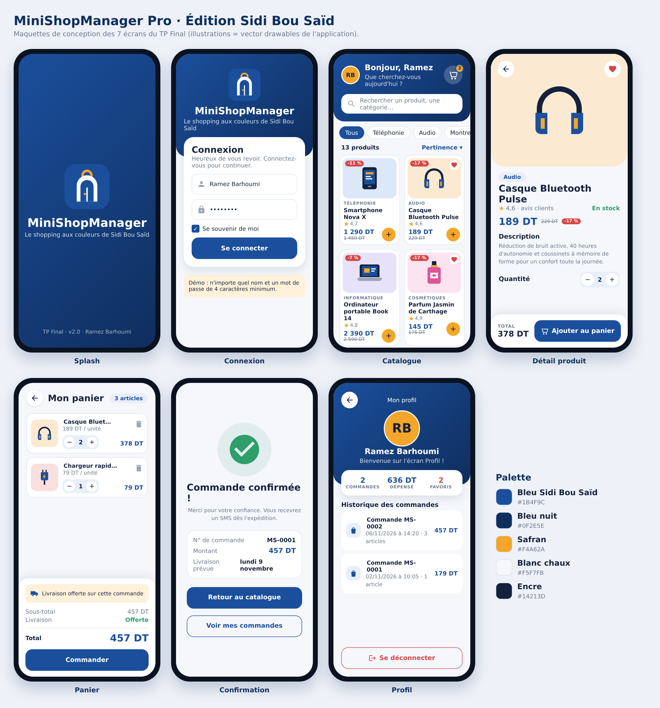

# MiniShopManager Pro · TP Programmation Mobile

Travaux pratiques Android (Kotlin, layouts XML) · **L3-GTIC, ISET'COM** · Année 2026–2027
Étudiant : **Ramez Barhoumi** · Enseignantes : Asma Ayari & Amani Chouikhi



> **TP Final · MiniShopManager Pro, édition Sidi Bou Saïd** : une boutique mobile complète aux couleurs de Sidi Bou Saïd
> (bleu des portes, blanc chaux, safran du jasmin), avec un logo en forme de porte en arche.

## Contenu du dépôt

| TP | Thème | Ce qui est réalisé | Explications |
|----|-------|--------------------|--------------|
| **TP0** | Environnement + dépôt GitHub | Projet Android Studio, `.gitignore`, wrapper Gradle | [docs/TP0.md](docs/TP0.md) |
| **TP1** | Premier projet Android | Accueil, Toast, logs du cycle de vie, Intent → `ProfileActivity` | [docs/TP1.md](docs/TP1.md) |
| **TP2** | Catalogue statique | Exercice `exercices/ListePays` + catalogue MiniShop (ListView, images, fond) | [docs/TP2.md](docs/TP2.md) |
| **TP3** | Catalogue dynamique | Exercice `exercices/MesCoursApp` + Login Remember Me, JSON, panier SQLite | [docs/TP3.md](docs/TP3.md) |
| **TP Final** | MiniShopManager Pro | 7 écrans, recherche, filtres, tri, panier avec quantités, commandes, favoris, profil, nouvelle identité visuelle | [docs/TP_FINAL.md](docs/TP_FINAL.md) |

Chaque TP correspond à **un commit** et à un **tag** (`tp0`, `tp1`, `tp2`, `tp3`, `tp-final`) :
`git checkout tp2` permet de revoir le projet exactement tel qu'il était à la fin du TP2.

## Fonctionnalités du TP Final

- **Splash** animé puis connexion automatique si « Se souvenir de moi » est actif.
- **Connexion** avec validation des champs, mot de passe masquable, Remember Me (SharedPreferences).
- **Catalogue** de 13 produits lus depuis `assets/produits.json`, affichés en **GridView** (cartes, promotions, note, favori).
- **Barre de recherche** en temps réel, **filtres par catégorie** (Chips) et **tri** (Spinner : prix, note, promotions).
- **Fiche produit** : grande illustration, description, stock, choix de la quantité, ajout aux **favoris**.
- **Panier** SQLite : quantités +/-, suppression avec **Annuler**, badge animé, livraison offerte dès 200 DT.
- **Commande** : confirmation, numéro `MS-0001`, date de livraison estimée, historique dans le **profil**.
- **Profil** : avatar à initiales, statistiques (commandes, total dépensé, favoris), déconnexion.
- **Illustrations** : 13 produits, logo et états vides dessinés en vector drawables (aucune image externe).

## Structure

```
MiniShopManager/                 ← projet principal (ouvrir ce dossier dans Android Studio)
├── app/src/main/
│   ├── AndroidManifest.xml
│   ├── java/com/example/minishopmanager/
│   │   ├── SplashActivity, LoginActivity, MainActivity, DetailActivity,
│   │   │   PanierActivity, ConfirmationActivity, ProfileActivity      ← écrans
│   │   ├── ProduitAdapter, PanierAdapter                              ← BaseAdapter
│   │   ├── Catalogue (JSON), DBHelper (SQLite), Session (SharedPreferences)
│   │   └── Produit, Format
│   ├── res/layout/              ← 12 layouts XML
│   ├── res/drawable/            ← logo, illustrations, icônes, formes
│   └── assets/produits.json     ← catalogue
├── exercices/ListePays/         ← exercice guidé du TP2
├── exercices/MesCoursApp/       ← exercice guidé du TP3
└── docs/                        ← explication de chaque TP + maquettes
```

## Ouvrir et lancer

1. Android Studio → **File → Open** → dossier `MiniShopManager`.
2. Attendre la synchronisation Gradle.
3. Émulateur (ex. Pixel 7a, API 34) → **Run ▶**.
4. Connexion de démonstration : n'importe quel nom + un mot de passe de 4 caractères minimum.

Configuration : Kotlin 1.9.24 · Android Gradle Plugin 8.5.2 · compileSdk 34 · minSdk 24 · JDK 17.
